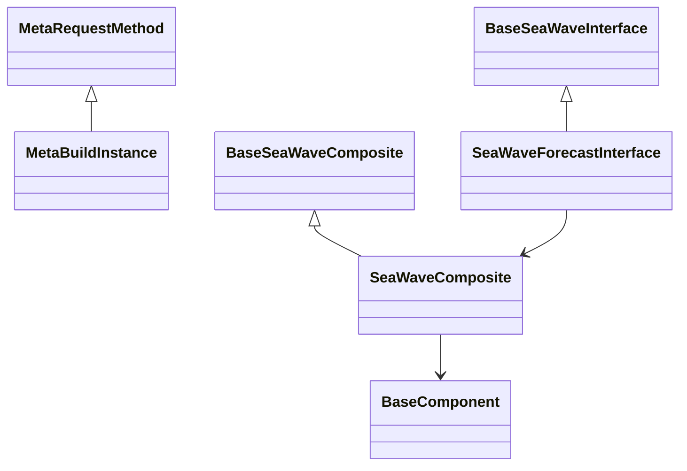

# SeaWave

English | [中文](README_Chinese.md)

## 1. introduce

### 1.1 SeaWave positioning

SeaWave is a time-series forecasting package built on JAX and LightGBM. It combines explicit trend and seasonal decomposition with gated residual learning to balance structural interpretability, forecast accuracy, and extrapolation robustness.

The package is intended for daily or weekly business series with trend changes, recurring seasonality, autocorrelated residuals, and known future promotion indicators. Its numerical core uses JAX, its residual and promotion learners use LightGBM, and NumPy provides validation, feature construction, metrics, and array bridging.

## 2. design

### 2.1 Core concepts

- **Interface**: a user-facing, function-like forecasting entry point.
- **Composite**: an algorithm workflow assembled from independently testable components.
- **Component**: one structural, residual, or exogenous algorithm node.
- **Mixin**: reusable numerical, learning, feature, metric, and backtest capabilities.
- **Metaclass**: class-creation interface checks and a five-stage Composite lifecycle.

### 2.2 Framework



`MetaBuildInstance` executes `preNew -> new -> preInit -> init -> postInit`. Component implementation files begin with an underscore, while each subpackage exposes its agreed public names through `__all__`.

### 2.3 Forecasting workflow

```text
y[1:n] and a known promotion path
    |
    v
P0: HP damping / polynomial / local-linear / global-linear candidates
    -> staggered worst-window scores -> flexibility penalties -> Top-K Softmax
    |
    v
P1: Fourier projection on each selected trend residual
    |
    v
P2: direct multi-step residual LightGBM -> held-out margin gate -> shrinkage
    |
    v
P3: promotion submodel fitted on the remaining residual
    |
    v
forecast = blended trend + blended seasonality + scaled G + promotion effect
```

### 2.4 Mathematical summary

SeaWave uses the product hypothesis space $\mathcal{H}=\mathcal{T}\times\mathcal{S}\times\mathcal{G}\times\mathcal{X}$ and the conceptual mixed block-coordinate objective:

$$
\min_{T,\beta,g,w}\|y-T-S\beta-g-Xw\|^2+\Omega(g)+\lambda\|\Delta^2T\|^2.
$$

For trend candidate $j$, the selection score uses the worst of $m$ staggered windows:

$$
s_j=\max_{k=1,\ldots,m}\left(\frac{\mathrm{MAE}_j^{(k)}}{\sigma^{(k)}}\right)(1+\gamma\,\mathrm{pen}_j).
$$

The HP trend solves $(I+\lambda K^T K)T=y$. Fourier coefficients use $(F^TF+\delta I)^{-1}F^T(y-T)$. The direct residual model includes horizon as a feature, avoiding recursive residual prediction.

The residual gate is activated only when held-out improvement exceeds the configured margin:

$$
\mathrm{rel}=\frac{\mathrm{MAE}_{base}-\mathrm{MAE}_{base+g}}{\mathrm{MAE}_{base}},\qquad
g_{scale}=\min\left(1,\frac{\mathrm{rel}}{g\_rel\_scale}\right).
$$

All G training targets precede the first gate origin. G is trained and predicted on the residual of the same fully fitted Top-K structure, preserving composition consistency.

## 3. use

### 3.1 How to get

```bash
git clone https://github.com/redblue0216/seawave.git
cd seawave
conda create -n seawave python=3.13.18 -y
conda activate seawave
python build.py --clean --install
```

After Conda environment activation, this single build command checks and installs llvm-openmp from conda-forge when missing, installs uv when needed, builds SeaWave, installs the wheel with all Python runtime dependencies, and verifies imports for SeaWave, JAX, JAXLIB, LightGBM, and NumPy. An active Conda environment is required because llvm-openmp is not a pip dependency.

The validated environment uses Python 3.13.18, JAX/JAXLIB 0.12.0.1, LightGBM 4.7.0, NumPy 2.5.4, and conda-forge llvm-openmp 23.1.5. Manual installation of these runtime dependencies is optional because build.py handles them automatically. build.py intentionally does not install pytest; install it separately before running tests.

Build options:

```bash
python build.py                 # Build source and wheel distributions
python build.py --clean         # Clean generated artifacts before building
python build.py --install       # Install the newest wheel
python build.py --verbose       # Show complete command output
```

### 3.2 How to use

The following complete example creates 914 days of synthetic data, trains on 900 days, and forecasts 14 days through the public Interface:

```python
import numpy as np
from seawave import SeaWaveConfig, SeaWaveForecastInterface

n, h = 900, 14
t = np.arange(n + h)
rng = np.random.default_rng(7)
promo = np.zeros(n + h)
promo[::21] = 1.0
y = 2.5 + 0.0022 * t + np.sin(2 * np.pi * t / 7) + 0.8 * promo
y += rng.normal(0, 0.1, n + h)

config = SeaWaveConfig(margin=0.05, tau=0.05, topk=2)
model = SeaWaveForecastInterface(config=config)
forecast, info = model(y=y[:n], h=h, promo=promo)

print(forecast)
print(info["top"])
print(info["weights"])
print(info["use_g"], info["g_scale"])
```

`promo` must contain known values for both training and future periods. Pass `promo=None` to disable the exogenous channel. The direct residual model supports `h <= config.g_hmax`; the default maximum is 14.

The returned `info` dictionary contains:

- `top`, `weights`, `scores`, and `window_scores` for structural selection;
- `use_g`, `g_scale`, and `relative_improvement` for residual control;
- `g_gate` with sample counts, baseline/gated MAE, and the gate reason.

Install pytest separately, then run all unit and end-to-end tests:

```bash
python -m pip install pytest
python -m pytest seawave/tests -v
```

### 3.3 Design documents

Algorithm text, formulas, architecture diagrams, and executable examples are integrated into the English source docstrings. Local design source documents are not required by the installed package.

## 4. algorithm

### 4.1 Which algorithms and models are covered?

| Module | Component | Algorithm | Key features |
|:---|:---|:---|:---|
| trend | HPTrendComponent | Dense HP trend with damped terminal-slope extrapolation | JAX float64 solve; configurable lambda and damping |
| trend | PolyTrendComponent | Global polynomial trend | Default quadratic curvature candidate |
| trend | RWTrendComponent | Recent-window linear trend | Local adaptation with bounded lookback |
| trend | GLinTrendComponent | Global linear trend | Conservative low-penalty endpoint |
| trend | TrendEnsembleComponent | Worst-window Top-K Softmax ensemble | Tail-risk control, flexibility penalties, stable weights |
| season | FourierSeasonComponent | Closed-form Fourier projection | JIT basis and ridge-stabilized JAX projection |
| residual | DirectGBDTComponent | Horizon-aware direct multi-step LightGBM | Temporally separated margin gate and shrinkage |
| exog | PromoLagComponent | Two-stage current and lagged promotion model | Independent residual learning and optional zero channel |
| diagnostics | ForecastDiagnostics | Typed structural and gate snapshots | Programmatic and serializable forecast diagnostics |

## 5. ChangeLog

### Version-0.1.1

- Added automatic llvm-openmp detection and conda-forge installation in build.py.
- Added complete post-install import verification for SeaWave, JAX, JAXLIB, LightGBM, and NumPy.
- Simplified installation to one build command after Conda environment activation.

### Version-0.1.0

- Established the Interface / Composite / Component / Mixin package architecture and metaclass lifecycle.
- Added validated SeaWaveConfig and the public forecasting Interface.
- Added four trend families, worst-window scoring, stable Top-K Softmax, and full-history trend ensembles.
- Added JIT Fourier bases and float64 closed-form seasonal projection.
- Added direct multi-step residual learning with temporally separated margin gating.
- Added two-stage promotion modeling with current and lagged indicators.
- Integrated the complete Composite workflow, typed diagnostics, and 93 unit/end-to-end tests.
- Added uv build, wheel installation verification, bilingual documentation, and English algorithm docstrings.
