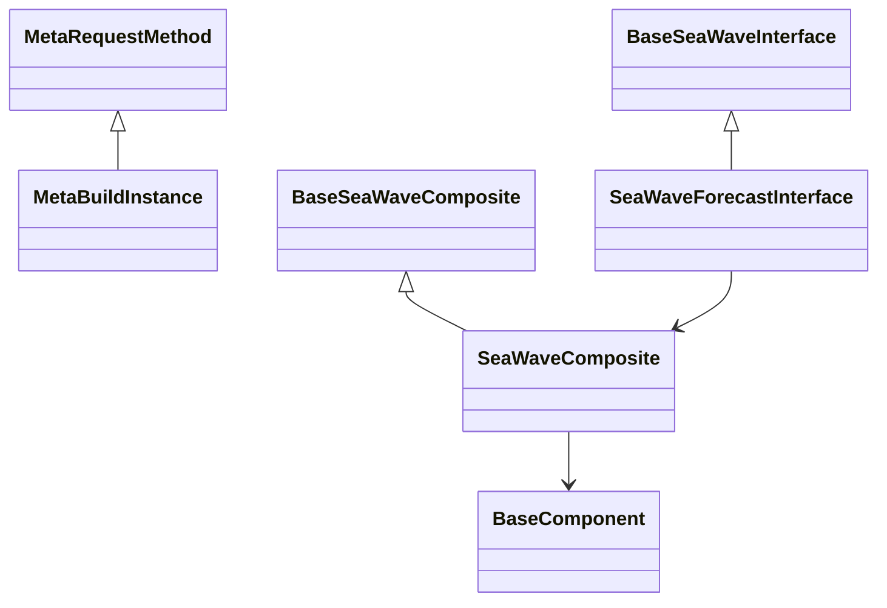

# SeaWave

[English](README.md) | 中文

## 1.介绍

### 1.1 SeaWave定位

SeaWave 是基于 JAX 和 LightGBM 的时间序列预测算法包。它将显式趋势、季节分解与门控残差学习结合起来，在结构可解释性、预测精度和外推稳健性之间取得平衡。

该算法包面向具有趋势变化、周期季节、残差自相关以及未来已知促销标记的日级或周级业务时间序列。数值核心使用 JAX，残差和促销学习器使用 LightGBM，NumPy 负责输入校验、特征构造、指标计算和数组桥接。

## 2.设计

### 2.1 核心概念

- **Interface（算法接口）**：对用户开放的函数式预测入口。
- **Composite（算法复合组件）**：由可独立测试的组件装配完整算法流程。
- **Component（算法节点组件）**：实现一个结构、残差或外生变量算法节点。
- **Mixin（功能混入）**：复用数值计算、学习、特征、指标和回测能力。
- **Metaclass（元类）**：在类创建时检查抽象接口，并管理 Composite 的五阶段实例创建流程。

### 2.2 框架



`MetaBuildInstance` 依次执行 `preNew -> new -> preInit -> init -> postInit`。组件实现文件使用下划线前缀，各子包通过 `__all__` 精确开放约定接口。

### 2.3 预测流程

```text
y[1:n] 和已知促销路径
    |
    v
P0：HP 阻尼 / 多项式 / 近窗线性 / 全局线性候选
    -> 错位最差窗口得分 -> 柔性度惩罚 -> Top-K Softmax
    |
    v
P1：在每个入选趋势残差上进行傅里叶投影
    |
    v
P2：直接多步残差 LightGBM -> 独立裕度门 -> 收缩
    |
    v
P3：在剩余残差上拟合促销子模型
    |
    v
预测 = 混合趋势 + 混合季节 + 收缩后的 G + 促销效应
```

### 2.4 数学原理摘要

SeaWave 使用乘积假设空间 $\mathcal{H}=\mathcal{T}\times\mathcal{S}\times\mathcal{G}\times\mathcal{X}$，其混合块坐标目标为：

$$
\min_{T,\beta,g,w}\|y-T-S\beta-g-Xw\|^2+\Omega(g)+\lambda\|\Delta^2T\|^2.
$$

趋势候选 $j$ 的选择得分取 $m$ 个错位窗口中的最差风险：

$$
s_j=\max_{k=1,\ldots,m}\left(\frac{\mathrm{MAE}_j^{(k)}}{\sigma^{(k)}}\right)(1+\gamma\,\mathrm{pen}_j).
$$

HP 趋势求解 $(I+\lambda K^T K)T=y$；傅里叶系数使用 $(F^TF+\delta I)^{-1}F^T(y-T)$。直接残差模型将 horizon 作为特征，避免递归残差预测。

仅当独立验证上的相对改善超过配置阈值时才启用残差门：

$$
\mathrm{rel}=\frac{\mathrm{MAE}_{base}-\mathrm{MAE}_{base+g}}{\mathrm{MAE}_{base}},\qquad
g_{scale}=\min\left(1,\frac{\mathrm{rel}}{g\_rel\_scale}\right).
$$

所有 G 训练目标都早于第一个门控原点。G 在同一 Top-K 全量结构残差上训练和预测，以保证组合一致性。

## 3.使用

### 3.1 如何获得

```bash
git clone https://github.com/redblue0216/seawave.git
cd seawave
conda create -n seawave python=3.13.18 -y
conda activate seawave
python build.py --clean --install
```

激活 Conda 环境后，这一条构建命令会在缺少 llvm-openmp 时自动从 conda-forge 安装，在需要时安装 uv，构建 SeaWave，通过 wheel 安装全部 Python 运行依赖，并验证 SeaWave、JAX、JAXLIB、LightGBM 和 NumPy 的导入。由于 llvm-openmp 不是 pip 依赖，运行前必须激活 Conda 环境。

已验证环境为 Python 3.13.18、JAX/JAXLIB 0.12.0.1、LightGBM 4.7.0、NumPy 2.5.4 和 conda-forge llvm-openmp 23.1.5。这些运行依赖由 build.py 自动处理，因此手动安装步骤均为可选。build.py 不安装 pytest，运行测试前需要单独安装。

构建选项：

```bash
python build.py                 # Build source and wheel distributions
python build.py --clean         # Clean generated artifacts before building
python build.py --install       # Install the newest wheel
python build.py --verbose       # Show complete command output
```

### 3.2 如何使用

以下完整示例生成 914 天模拟数据，使用前 900 天训练，并通过公共 Interface 预测未来 14 天：

```python
import numpy as np
from seawave import SeaWaveConfig, SeaWaveForecastInterface

n, h = 900, 14
t = np.arange(n + h)
rng = np.random.default_rng(7)
promo = np.zeros(n + h)
promo[::21] = 1.0
y = 2.5 + 0.0022 * t + np.sin(2 * np.pi * t / 7) + 0.8 * promo
y += rng.normal(0, 0.1, n + h)

config = SeaWaveConfig(margin=0.05, tau=0.05, topk=2)
model = SeaWaveForecastInterface(config=config)
forecast, info = model(y=y[:n], h=h, promo=promo)

print(forecast)
print(info["top"])
print(info["weights"])
print(info["use_g"], info["g_scale"])
```

`promo` 必须同时包含训练期和未来期已知标记。传入 `promo=None` 可关闭外生变量通道。直接残差模型支持 `h <= config.g_hmax`，默认最大预测步长为 14。

返回的 `info` 字典包含：

- 用于结构选择的 `top`、`weights`、`scores` 和 `window_scores`；
- 用于残差控制的 `use_g`、`g_scale` 和 `relative_improvement`；
- 包含样本数、基线/门控 MAE 和门控原因的 `g_gate`。

单独安装 pytest，然后运行全部单元测试和端到端测试：

```bash
python -m pip install pytest
python -m pytest seawave/tests -v
```

### 3.3 设计文档

算法文字、公式、架构图和可执行示例已整合到英文源码文档字符串中。安装后的算法包不依赖本地设计源文档。

## 4.算法

### 4.1 覆盖哪些算法和模型

| 模块 | 组件 | 算法 | 关键特性 |
|:---|:---|:---|:---|
| trend | HPTrendComponent | 带阻尼末端斜率外推的稠密 HP 趋势 | JAX float64 求解；lambda 和阻尼可配置 |
| trend | PolyTrendComponent | 全局多项式趋势 | 默认二次弯曲候选 |
| trend | RWTrendComponent | 近窗线性趋势 | 有界回看窗口的局部适配 |
| trend | GLinTrendComponent | 全局线性趋势 | 低惩罚保守端点 |
| trend | TrendEnsembleComponent | 最差窗口 Top-K Softmax 软集成 | 尾部风险控制、柔性度惩罚、稳定权重 |
| season | FourierSeasonComponent | 闭式傅里叶投影 | JIT 基和带岭正则的 JAX 投影 |
| residual | DirectGBDTComponent | horizon 感知的直接多步 LightGBM | 独立时序裕度门和收缩 |
| exog | PromoLagComponent | 使用当期及滞后促销标记的两阶段模型 | 独立残差学习和可选零通道 |
| diagnostics | ForecastDiagnostics | 结构化类型诊断快照 | 可编程读取和序列化的预测诊断 |

## 5.ChangeLog

### Version-0.1.1

- 在 build.py 中新增 llvm-openmp 自动检测和 conda-forge 安装。
- 新增 SeaWave、JAX、JAXLIB、LightGBM 和 NumPy 的完整安装后导入验证。
- 将安装流程简化为激活 Conda 环境后的一条构建命令。

### Version-0.1.0

- 建立 Interface / Composite / Component / Mixin 四层架构和元类生命周期。
- 新增经过校验的 SeaWaveConfig 和公共预测 Interface。
- 新增四类趋势、最差窗口评分、稳定 Top-K Softmax 和全历史趋势软集成。
- 新增 JIT 傅里叶基和 float64 闭式季节投影。
- 新增带独立时序裕度门的直接多步残差学习。
- 新增使用当期及滞后促销标记的两阶段促销建模。
- 集成完整 Composite 流程、类型化诊断和 93 项单元/端到端测试。
- 新增 uv 构建、wheel 安装验证、双语文档和英文算法文档字符串。
